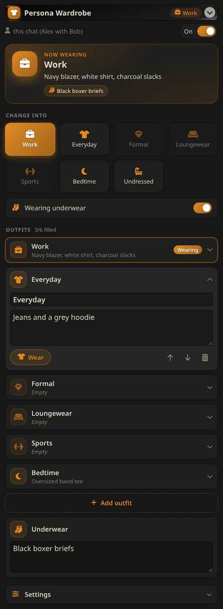
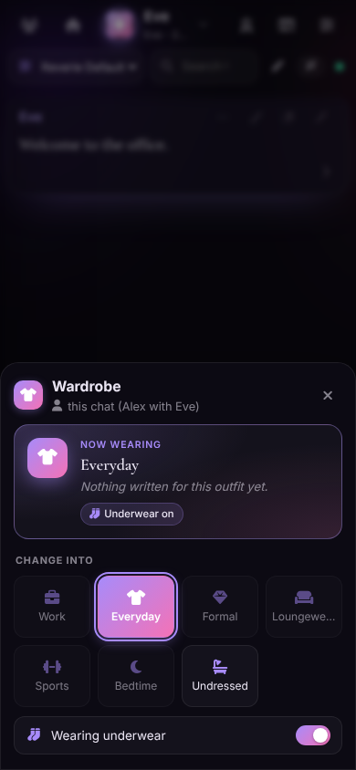

# Persona Wardrobe

A SillyTavern extension that tracks what **your persona** is wearing and keeps the model aware of it every reply.
It works in [SillyTavern](https://github.com/SillyTavern/SillyTavern) and [Reverie](https://github.com/howardsierra/roleplay-frontend-personal).

  
  

## Features

- **Per-chat wardrobes (default).** Each chat has its own wardrobe, saved inside the chat file, so the same persona can dress
  completely differently on different cards or in different storylines. Branching a chat copies its wardrobe.
  A brand-new chat starts from the last wardrobe you used with that persona + character (or your persona's wardrobe), so you don't retype everything.
- **Other scopes** if you prefer: *Per persona* (one wardrobe that follows you everywhere), *Per character*, or *Per persona + character*.
- **Looks at home in your theme.** A "Now wearing" card, tap-to-wear outfit tiles, and expandable outfit editors with an icon picker.
  Colours come from your SillyTavern or Reverie theme.
- **Quick switch from the chat.** Open the wand / ✨ menu next to the message box and choose **Wardrobe** to change outfits without opening the settings. On phones it opens as a bottom sheet.
- **Your own outfit slots.** Starts with Work, Everyday, Formal, Loungewear, Sports, Bedtime. Rename, reorder, delete, or add as many as you like.
- **Underwear layer** with an on/off toggle.
- **Always-worn details: Nails and Jewelry.** These stay the same whatever outfit you're in. Add your own too (makeup, hair, perfume, tattoos…) with **Add detail**, and rename them or pick an icon.
  The model can change them as well, for example when a character paints your nails or gives you a necklace.
- **Prompt injection.** The model is told what you're currently wearing. Position, depth and role are configurable.
- **Model-driven changes (optional).** The model can change your outfit when the story calls for it by ending its reply with a hidden tag
  `<wardrobe outfit="bedtime" underwear="off" jewelry="a single strand of pearls"/>`. The extension applies it, strips the tag from the message, and shows a small notification (which you can turn off).
- **Slash commands**
  - `/outfit <name>` (alias `/wardrobe`): change outfit (`/outfit none` for undressed). With no name, it returns what you're wearing.
  - `/underwear on|off|toggle`
  - `/nails <description>` and `/jewelry <description>`: set them (`none` clears). With no text, they return the current description.
- **Macros** for use in cards, Author's Note, Quick Replies, etc.: `{{outfit}}`, `{{outfit_name}}`, `{{outfit_text}}`, `{{underwear}}`, `{{nails}}`, `{{jewelry}}`.

Nothing is ever auto-filled. Every outfit is text you type in. Empty outfits aren't offered to the model, and if the wardrobe is completely empty nothing is injected.

## Install

**From URL:** In SillyTavern, open *Extensions → Install extension* and paste
`https://github.com/howardsierra/persona-wardrobe`.

**Manual:** Clone or download this repository into
`public/scripts/extensions/third-party/persona-wardrobe` (or `data/<user>/extensions/`), then reload SillyTavern.

Then open the Extensions panel and expand **Persona Wardrobe**.

## Notes

- In *Per chat* mode with no chat open, edits go to your persona's wardrobe.
- The current persona is read from SillyTavern's persona manager (by avatar), so two personas with the same name still get separate wardrobes.
- Existing data from the original Wardrobe extension isn't imported. It uses a different settings key, so both can be installed side by side (but don't enable both, or the model gets two clothing prompts).

## License

MIT
