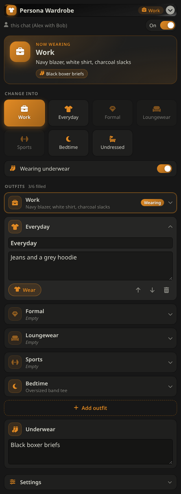
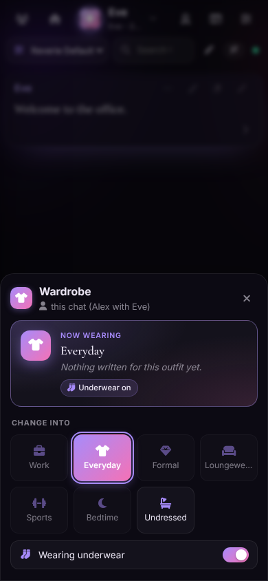

# Persona Wardrobe

A SillyTavern extension that tracks what **your persona** is wearing and keeps the model aware of it every reply.
It works in [SillyTavern](https://github.com/SillyTavern/SillyTavern) and [Reverie](https://github.com/howardsierra/roleplay-frontend-personal).

  
  

## Features

- **Stylist.** Reads your persona's description and dresses them to match: every outfit, underwear, hair, nails and jewelry, all in their style and fitted to the story's setting.
  - New, empty wardrobes are styled **automatically** the first time you open a chat.
  - Use **Fill empty slots** to fill in only the blanks, or **Restyle everything** after you've changed the persona. Both can be undone, and the panel tells you when the description has changed since the last styling.
  - Anything the description already says ("always wears silver rings", "messy black hair") is used exactly.
- **Outfit builder.** Put an outfit together piece by piece: top, bottom (or a dress / one-piece), outerwear, shoes and accessories.
  - Pick from a catalogue of about 3,000 clothing pieces, filtered by search, style, colour and women's or men's cuts, or type in your own.
  - **Surprise me** fills the empty slots at random, and **Stylist pick** has the stylist finish the outfit in your persona's style.
  - Open it with **Build** on any outfit, or **Build outfit** to make a new one.
- **Makeup picker.** **Browse looks** on the Makeup card opens 121 makeup looks:
  - a **Black skin tones** collection of 51 looks made for deep and rich brown skin: everyday glow, soft glam, bold lips, colour pop, night out, bridal and formal, editorial, and men's grooming
  - 70 more from CLOVER OOC (Everyday & Soft, Classic & Polished, Bright Night Out, Glitter & Metallic, Gothic & Dark, Fantasy & Ethereal, Pink Glam).
  - Search them, get a surprise pick, or press **Match my outfit** and the stylist picks the look that suits what you're wearing and what's happening, and says why.
- **Hair picker.** **Browse hairstyles** on the Hair card opens over 300 hairstyles:
  - a **Black hairstyles** collection of 110 styles: braids and cornrows (knotless, stitch, lemonade…), Fulani braids (classic, knotless, boho, flip-over, heart part, zig-zag, bob, jumbo, with cowrie shells or gold thread, ponytail, half-up, stitch, men's Fulani-inspired cornrows…), Jayda Wayda braids (Fulani or feed-in braids in front with crochet curls, deep wave, body wave or bone-straight hair at the back, curly bob, half-up, side swoop, reverse…), twists and locs (Senegalese, passion, faux, butterfly, microlocs…), natural styles (afros, puffs, twist-outs, Bantu knots, wash-and-gos…), pressed and sleek styles (silk press, finger waves…), men's cuts and waves (360 waves, high-tops, fades, sponge twists…) and wraps, bonnets and durags
  - 230 more from CLOVER OOC, from pixie cuts to fantasy and historic styles.
  - Filter by length, texture, vibe and cut, or search. Your **hair colour** is picked up from your current hair and kept when you switch styles.
- **Hair colour picker.** **Hair colour** on the Hair card (or the palette in the hair picker) recolours your hair and keeps the style: natural and fashion swatches, effects (dark roots, highlights, balayage, ombré, skunk stripe, money pieces, peekaboo colour, grey streaks), and a **Custom…** colour wheel that names whatever colour you pick.
  - **Match my look** has the stylist pick a style that suits your outfit and the scene and that your hair could realistically be styled into.
- **Nail art picker.** **Browse nail art** on the Nails card opens 93 designs: classic and minimal, French and tips, chrome, glazed and aura, cute and playful, floral, glam and bling, gothic and edgy, short and natural, and seasonal. Filter by vibe and colour. Your nail **length and shape** are picked up from your current nails and kept when you switch designs, and **Match my outfit** has the stylist choose.
- **Outfit ideas.** Tell the stylist the occasion ("rooftop date at sunset", "hiking in the rain") and it builds three outfits to choose from, each with makeup to match. Ideas come with a matching hairstyle, makeup and nails. Wear one as it is, or open it in the builder to tweak it first.
  - When the scene check notices the story heading to an event or venue none of your outfits suit, the stylist builds ideas on its own and a notification asks you to pick one. Tap it, or use the banner on the "Now wearing" card.
- **Automatic outfit changes.** After character replies, a short scene check picks the outfit that fits what's happening: pyjamas when you head to bed, workout clothes at the gym, back to work clothes the next morning. It only changes when the story clearly calls for it.
  - It sends one small extra request per reply (or every 2, 3 or 5 replies). Send these to a cheaper sidecar model (below), or turn the check off.
- **Sidecar model.** The stylist, scene check and outfit ideas can use a different, cheaper model than your story. In Settings → Sidecar model, pick:
  - a **connection profile** you already have, or
  - the **Sidecar API**: choose a provider (OpenRouter, OpenAI, DeepSeek, Google AI Studio, Mistral, NanoGPT, Ollama, LM Studio, KoboldCpp or any OpenAI-compatible URL), paste an API key, then **Load models** and **Test connection**.
  - The sidecar is called straight from your browser. The key is stored with your extension settings (not encrypted). Local servers need to allow requests from the page (CORS); if a provider blocks browser requests, use a connection profile instead.

- **Per-chat wardrobes (default).** Each chat has its own wardrobe, saved inside the chat file, so the same persona can dress
  completely differently on different cards or in different storylines. Branching a chat copies its wardrobe.
  A brand-new chat starts from the last wardrobe you used with that persona + character (or your persona's wardrobe), so you don't retype everything.
- **Other scopes** if you prefer: *Per persona* (one wardrobe that follows you everywhere), *Per character*, or *Per persona + character*.
- **Looks at home in your theme.** A "Now wearing" card, tap-to-wear outfit tiles, and expandable outfit editors with an icon picker.
  Colours come from your SillyTavern or Reverie theme.
- **Quick switch from the chat.** Open the wand / ✨ menu next to the message box and choose **Wardrobe** to change outfits without opening the settings. On phones it opens as a bottom sheet.
- **Your own outfit slots.** Starts with Work, Everyday, Formal, Loungewear, Sports, Bedtime. Rename, reorder, delete, or add as many as you like.
- **Underwear layer** with an on/off toggle.
- **Always-worn details: Hair, Makeup, Nails and Jewelry.** These stay the same whatever outfit you're in. Add your own too (perfume, tattoos, glasses…) with **Add detail**, and rename them or pick an icon.
  The model can change them as well, for example when a character braids your hair, paints your nails or gives you a necklace.
- **Prompt injection.** The model is told what you're currently wearing. Position, depth and role are configurable.
- **Model-driven changes (optional).** The model can change your outfit when the story calls for it by ending its reply with a hidden tag
  `<wardrobe outfit="bedtime" underwear="off" jewelry="a single strand of pearls"/>`. The extension applies it, strips the tag from the message, and shows a small notification (which you can turn off).
- **Slash commands**
  - `/outfit <name>` (alias `/wardrobe`): change outfit (`/outfit none` for undressed). With no name, it returns what you're wearing.
  - `/underwear on|off|toggle`
  - `/hairstyle <name|random>`: style your hair by name (or at random), keeping your hair colour. With no name, opens the hair picker.
  - `/hair-colour <colour>`: recolour your hair, keeping the style ("copper", "jet black with honey highlights"). With no colour, opens the colour picker.
  - `/nail-art <name|random>`: paint your nails with a design by name (or at random), keeping their length and shape.
  - `/makeup-look <name|random>`: wear a makeup look by name (or a random one). With no name, opens the picker.
  - `/plan-outfit <occasion>`: get three outfit ideas for an occasion and choose one.
  - `/stylist [fill|all|undo]`: run the stylist (fill empty slots by default), restyle everything, or undo the last styling.
  - `/hair`, `/makeup`, `/nails` and `/jewelry` followed by a description: set them (`none` clears). With no text, they return the current description.
- **Macros** for use in cards, Author's Note, Quick Replies, etc.: `{{outfit}}`, `{{outfit_name}}`, `{{outfit_text}}`, `{{underwear}}`, `{{hair}}`, `{{makeup}}`, `{{nails}}`, `{{jewelry}}`.

Nothing is ever auto-filled. Every outfit is text you type in. Empty outfits aren't offered to the model, and if the wardrobe is completely empty nothing is injected.

## Install

**From URL:** In SillyTavern, open *Extensions → Install extension* and paste
`https://github.com/howardsierra/persona-wardrobe`.

**Manual:** Clone or download this repository into
`public/scripts/extensions/third-party/persona-wardrobe` (or `data/<user>/extensions/`), then reload SillyTavern.

Then open the Extensions panel and expand **Persona Wardrobe**.

## Notes

- In *Per chat* mode with no chat open, edits go to your persona's wardrobe.
- The current persona is read from SillyTavern's persona manager (by avatar), so two personas with the same name still get separate wardrobes.
- Existing data from the original Wardrobe extension isn't imported. It uses a different settings key, so both can be installed side by side (but don't enable both, or the model gets two clothing prompts).

## Credits

The outfit builder's clothing pieces, the makeup looks and most hairstyles come from [CLOVER OOC](https://github.com/aceeenvw/clover-ooc) by **aceenvw**, used under its license, which requires this credit and link for public reuse.
They are in `data/pieces.json`, `data/makeup.json` and `data/hair.json`; please keep this credit if you share or adapt the extension.
The Black hairstyles (`data/hair-black.json`), makeup for Black skin tones (`data/makeup-black.json`) and nail art (`data/nails.json`) were written for Persona Wardrobe and are MIT like the code.

## License

The code, `data/hair-black.json`, `data/makeup-black.json` and `data/nails.json` are MIT. `data/pieces.json`, `data/makeup.json` and `data/hair.json` are not covered by the MIT license: it stays under [CLOVER OOC's terms](https://github.com/aceeenvw/clover-ooc#-license) (credit aceenvw and link the repository; don't claim it as your own or repackage it for sale).
